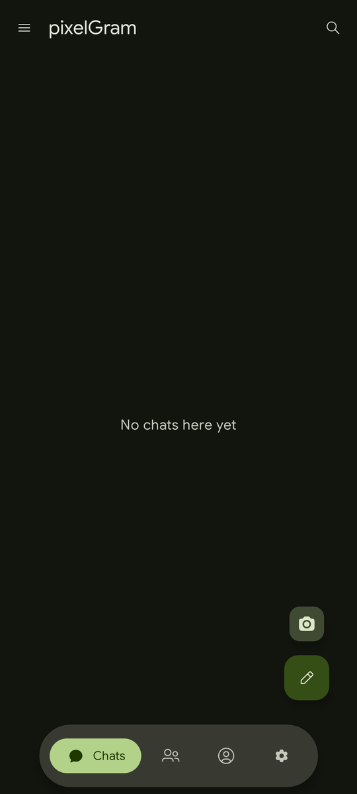
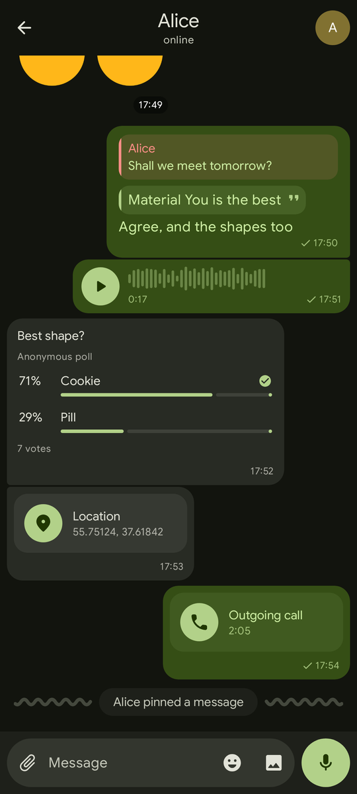
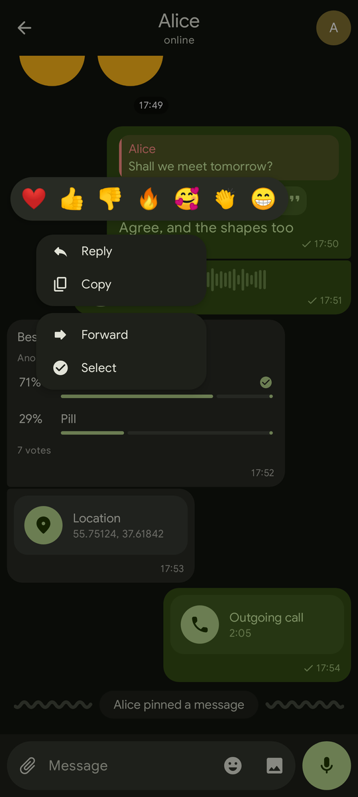
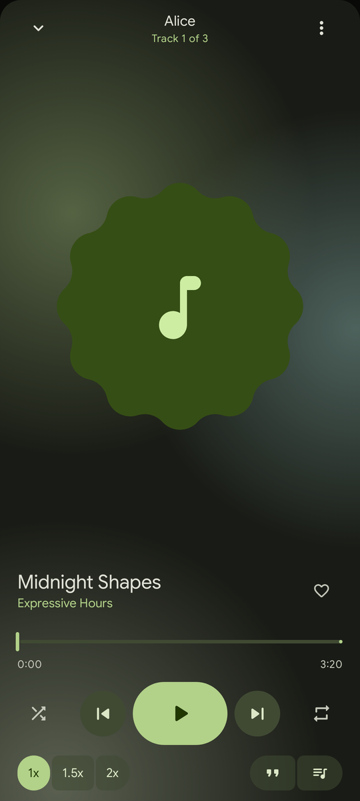
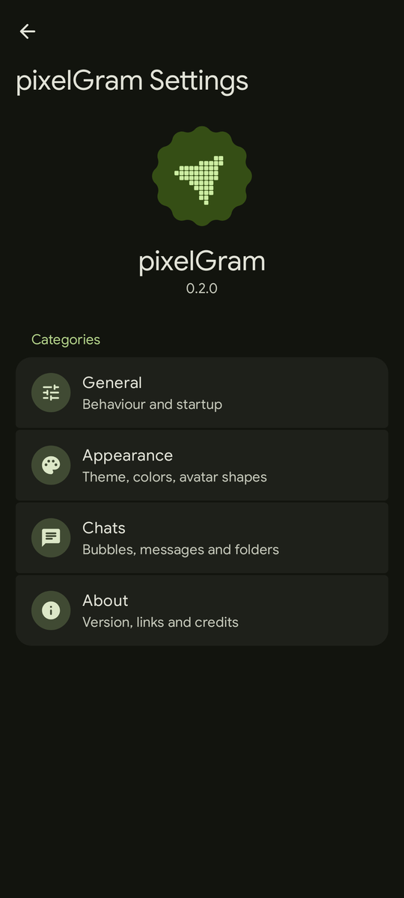

<p align="center"></p>

<h1 align="center">pixelGram Android</h1>

<p align="center"><a href="README.ru.md">Русский</a></p>

<p align="center"><a href="https://rookieenough.github.io/Orion-Data/app/?id=pixelgram"></a></p>

A Telegram client for Android written from scratch in Kotlin and Jetpack Compose with Material 3 Expressive, built on [TDLib](https://github.com/tdlib/td).

Companion of [pixelGram Desktop](https://github.com/JettaXP/pixelGram).

## Screenshots

| | | |
|:-:|:-:|:-:|
|  |  |  |
|  |  |  |

## Status

Early development. Working now: sign in by phone, code, 2FA password and QR; chat list with folders as chips and archive; chats with replies and swipe-to-reply; contacts; profile with an expressive QR code; active sessions; pixelGram Settings (theme, dynamic color, monochrome, avatar shapes, hidden phone number).

## Building

1. Build TDLib for Android (`example/android` in the TDLib repository, commit pinned in `.github/workflows/build.yml`) and put the resulting `.so` files into `tdlib/src/main/jniLibs/<abi>/`.
2. Add your Telegram API credentials from [my.telegram.org](https://my.telegram.org) to `local.properties`:
   ```
   API_ID=...
   API_HASH=...
   ```
3. Run `./gradlew :app:assembleDebug` (optionally `-PtargetAbi=arm64-v8a`).

CI does all of this automatically and caches the TDLib build.

## Credits

- [TDLib](https://github.com/tdlib/td) — Telegram Database Library
- [Mategram](https://github.com/MG-Devs-Team/Mategram) — design ideas for the numeric keypad and swipe-to-reply
- Material 3 Expressive by Google

## License

GPL-3.0
