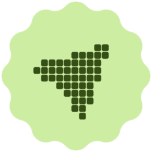
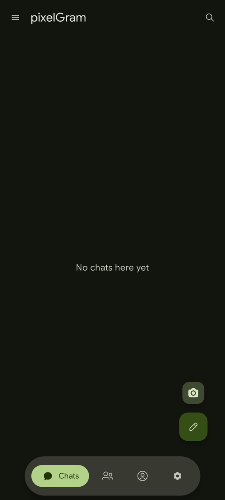
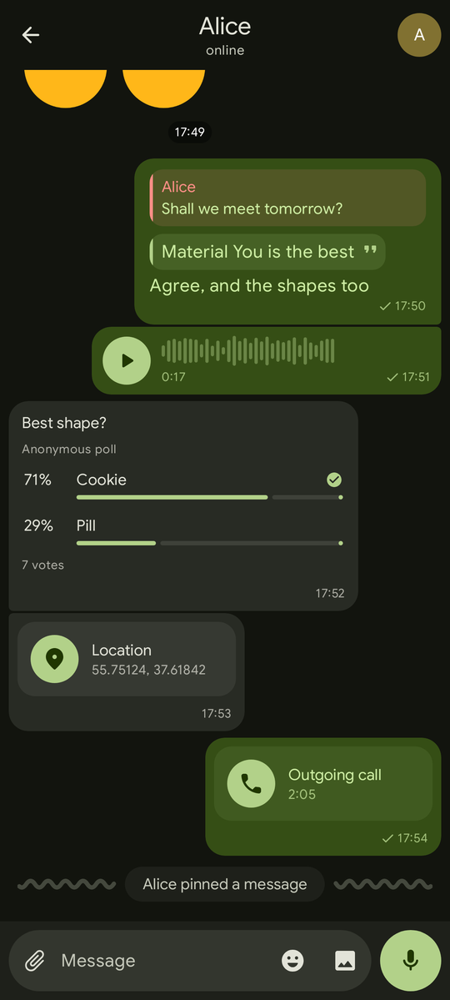
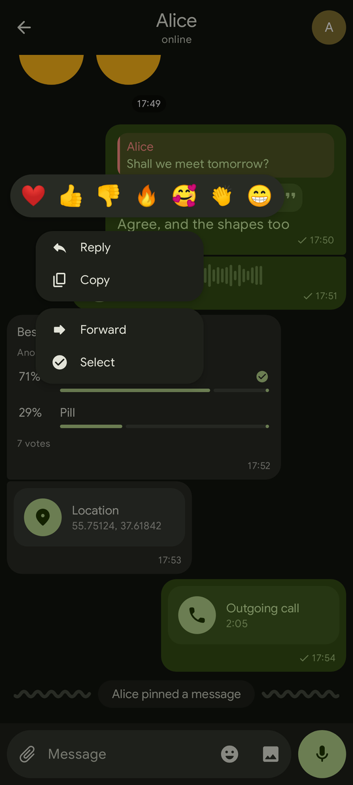
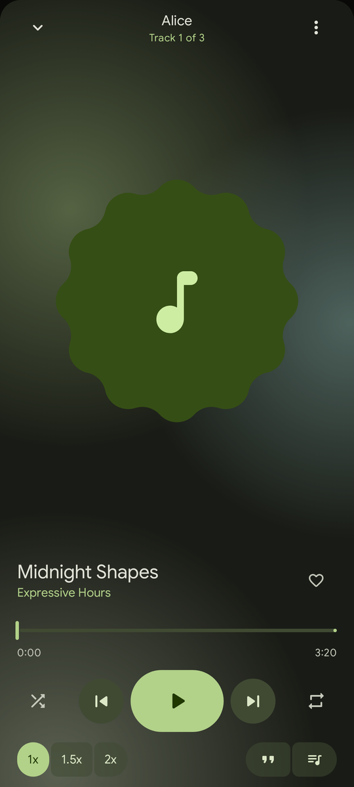
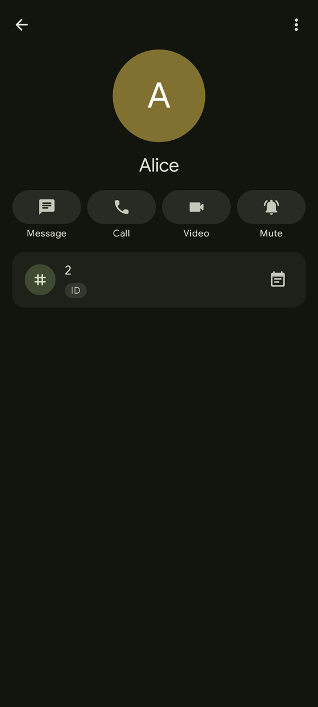
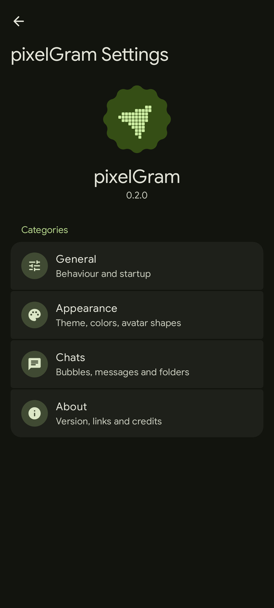

<p align="center"></p>

<h1 align="center">pixelGram для Android</h1>

<p align="center"><a href="README.md">English</a></p>

<p align="center"><a href="https://rookieenough.github.io/Orion-Data/app/?id=pixelgram"></a></p>

Клиент Telegram для Android, написанный с нуля на Kotlin и Jetpack Compose в стиле Material 3 Expressive, на основе [TDLib](https://github.com/tdlib/td).

Компаньон [pixelGram Desktop](https://github.com/JettaXP/pixelGram).

## Скриншоты

| | | |
|:-:|:-:|:-:|
|  |  |  |
|  |  |  |

## Статус

Ранняя разработка. Уже работает: вход по номеру, коду, паролю 2FA и QR; список чатов с папками-чипами и архивом; чаты с ответами и свайпом для ответа; контакты; профиль с выразительным QR-кодом; активные сеансы; настройки pixelGram (тема, динамические цвета, монохром, формы аватарок, скрытие номера).

## Сборка

1. Соберите TDLib для Android (`example/android` в репозитории TDLib, коммит указан в `.github/workflows/build.yml`) и положите `.so` в `tdlib/src/main/jniLibs/<abi>/`.
2. Добавьте API-ключи Telegram с [my.telegram.org](https://my.telegram.org) в `local.properties`:
   ```
   API_ID=...
   API_HASH=...
   ```
3. Запустите `./gradlew :app:assembleDebug` (можно с `-PtargetAbi=arm64-v8a`).

CI делает всё это сам и кэширует сборку TDLib.

## Благодарности

- [TDLib](https://github.com/tdlib/td) — Telegram Database Library
- [Mategram](https://github.com/MG-Devs-Team/Mategram) — идеи дизайна цифровой клавиатуры и свайпа для ответа
- Material 3 Expressive от Google

## Лицензия

GPL-3.0
